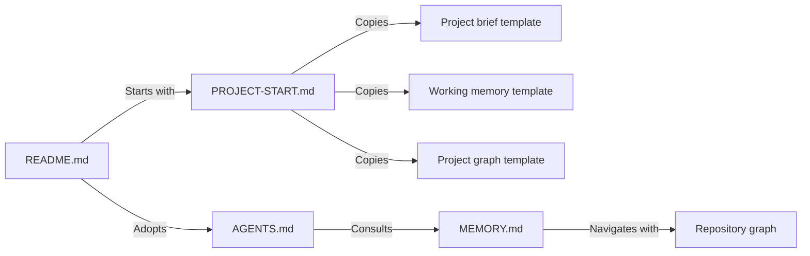

# Repository Graph

This map describes this documentation-only repository. Arrows represent documented navigation and adoption relationships, not application runtime dependencies. Reusable application graph nodes in the template remain illustrative until an adopting project verifies them.

## Navigation

## Components and verified sources

| Component | Important paths | Responsibility / evidence |
| --- | --- | --- |
| Overview | [README.md](../README.md) | Adoption entry point and repository file index |
| Policy | [AGENTS.md](../AGENTS.md) | Engineering rules, autonomy, checkpoint and persistent-context requirements |
| Startup | [PROJECT-START.md](../PROJECT-START.md) | Bootstrap and resume instructions; canonical startup prompt |
| Product brief | [templates/PROJECT.md](../templates/PROJECT.md) | Adopting project's requirements, milestone ledger, and durable decisions |
| Snapshot | [MEMORY.md](../MEMORY.md), [template](../templates/MEMORY.md) | Actual repository handoff and reusable current-state template |
| Graph | [template](../templates/docs/PROJECT-GRAPH.md), this file | Reusable module/check map and actual documentation relationships |
| Maintenance | [CONTRIBUTING.md](../CONTRIBUTING.md), [CHANGELOG.md](../CHANGELOG.md) | Rule-ID compatibility, contribution review, and policy changes |
| License | [LICENSE](../LICENSE) | License source; the portable policy contains a matching notice |

## Change-to-check mapping

| Change area | Relevant verification | Limits |
| --- | --- | --- |
| Policy rules | Unique IDs, valid references, preserved existing rule semantics, diff review | Material meaning changes need a changelog entry |
| Documentation and templates | Local links, English text, Markdown fences, whitespace, and adoption-path consistency | Template placeholders are not real application paths |
| Shell examples | `bash -n` on extracted `sh` blocks | Syntax only; do not execute commands that create repositories or alter authentication during documentation checks |
| Mermaid maps | Node/edge consistency and diagram review; render when an available renderer supports it | Structural checks alone do not establish rendered layout |
| Portable policy license | Compare the embedded notice with `LICENSE` | Linked third-party content retains its own license |

## Freshness and gaps

Verified scope is the named documents and adoption links on the memory/graph feature branch, based on commit `0754e297cb8898700b1196f9ecd40884f6c9f86c`. Consult the snapshot for subsequent checkpoints and check results; this map does not contain a live test-status log.

Refresh affected rows when files move, responsibilities change, or adoption/check mappings change. The repository has no application routes, database, runtime test suite, or committed executable validator. Do not invent those components from the reusable example.
