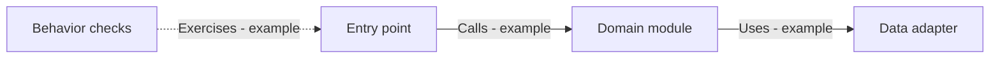

# Project Graph

Copy to `docs/PROJECT-GRAPH.md` in the adopting project. Map the relevant implemented components and checks; expand when the task requires it. Do not enumerate every function or scan the whole repository simply to fill this template.

## Scope and freshness

| Field | Value |
| --- | --- |
| Mapped area | Not mapped yet |
| Verified against existing commit / local scope | To be recorded |
| Unmapped areas and unknown edges | All project relationships until verified |
| Update trigger | Changed entry points, responsibilities, paths, dependencies, or check mappings |

## Diagram

The following is an **illustrative, unverified example**, not a required architecture. Replace it with evidence from the actual project. An application without persistence does not need a storage component.

In the real map, state what each arrow means. Distinguish verified dependencies from planned or unknown relationships in labels and the table. Diagram nodes are navigation aids; they do not prove that the map is complete.

## Components and evidence

| Component | Entry point / important paths | Responsibility | Depends on | Evidence and confidence |
| --- | --- | --- | --- | --- |
| Not mapped | To be inspected | To be established | Unknown | Unverified; replace with actual file or symbol references |

## Change-to-check mapping

| Change area | Related components / likely callers | Relevant checks and where defined | Gaps or uncertainty |
| --- | --- | --- | --- |
| Not mapped | Unknown | No checks mapped yet | Inspect relevant code and project configuration |

Keep check definitions here and run results in `MEMORY.md` or the project's existing evidence record. Resolve actual paths and check commands before relying on a row. A missing test mapping does not mean no tests are needed.

Update affected entries after structural changes, keep unrelated sections untouched, and split large maps by module when necessary. Record durable design rationale in existing architecture/decision documents and reference it here. No external graph service or generated index is required.
